#  ThorPad

🎮 A simple trackpad with bonus features designed for the AYN Thor.

🖱️ Turns the AYN Thor's bottom screen into a laptop-style trackpad for a mouse pointer on the top screen, plus a full-screen keyboard ⌨️ for typing.

## 📸 Screens

Everything happens on the Thor's bottom screen (1240 × 1080).

| 🖱️ Trackpad | ⌨️ Keyboard with autocorrect |
|---|---|
| 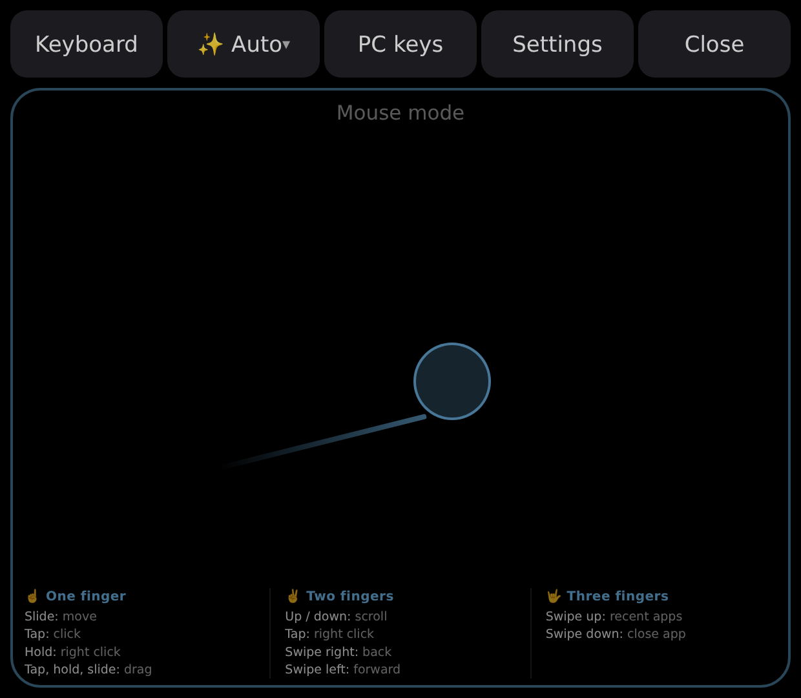 | 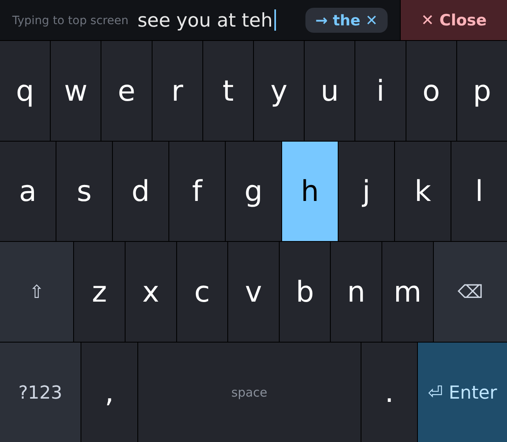 |
| 🔣 Numbers and symbols | ⚙️ Settings |
| 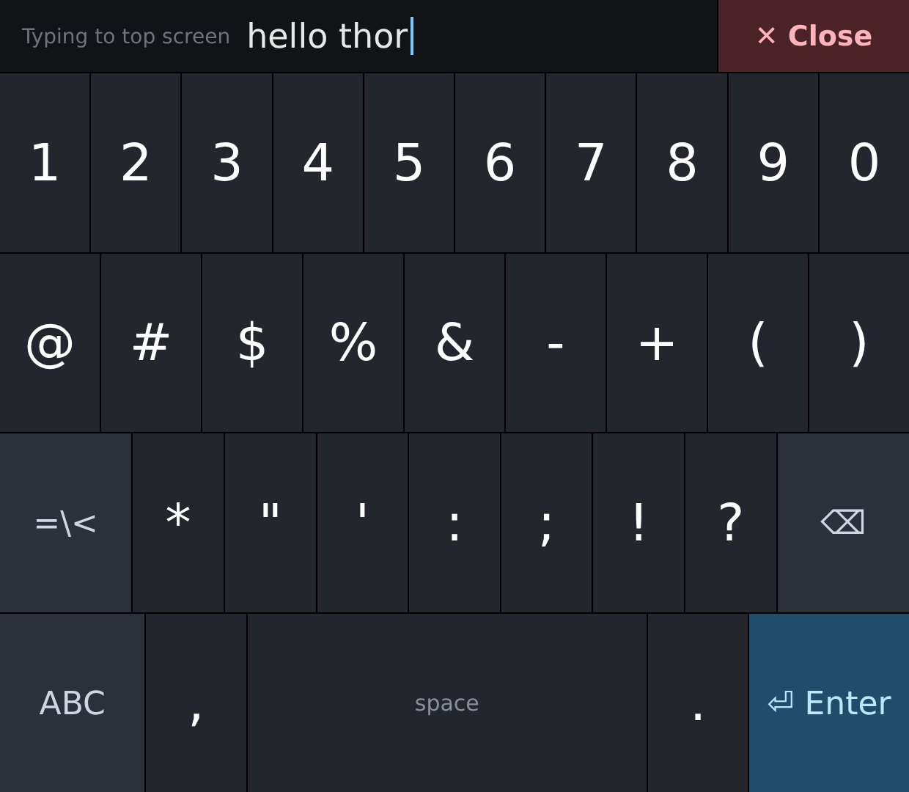 | 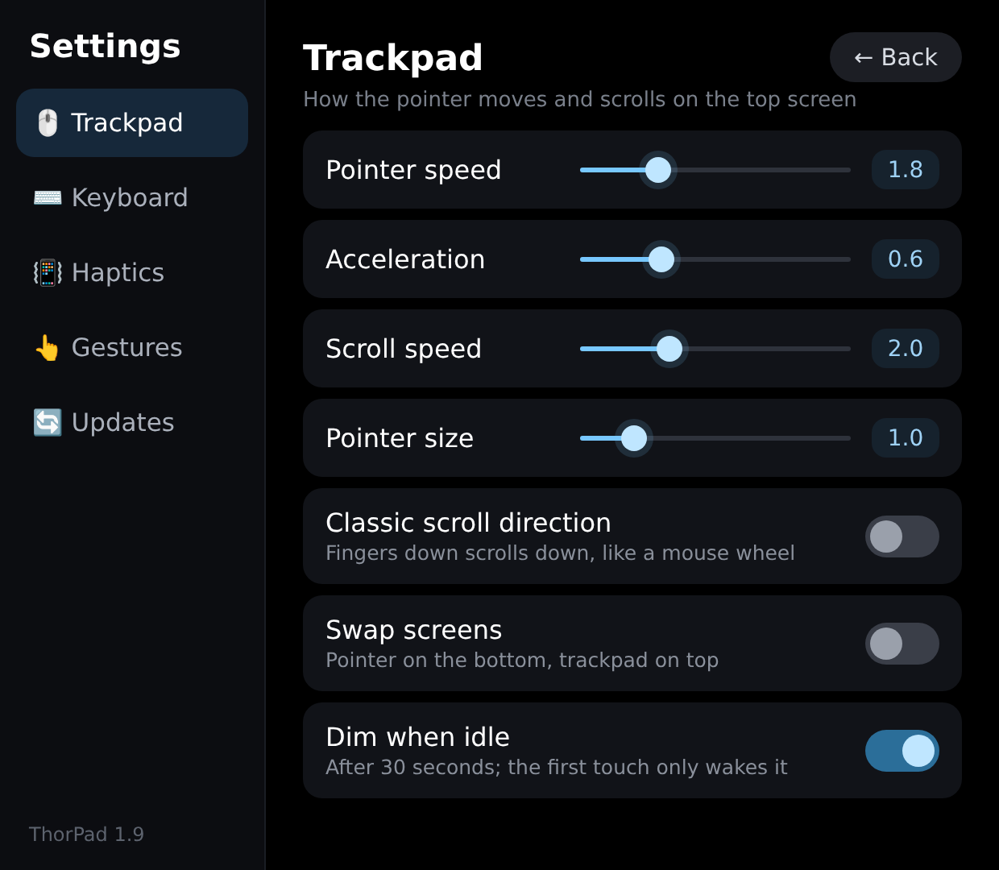 |
| 🧹 Hold ⌫ for Clear all | 📳 Haptics settings |
| 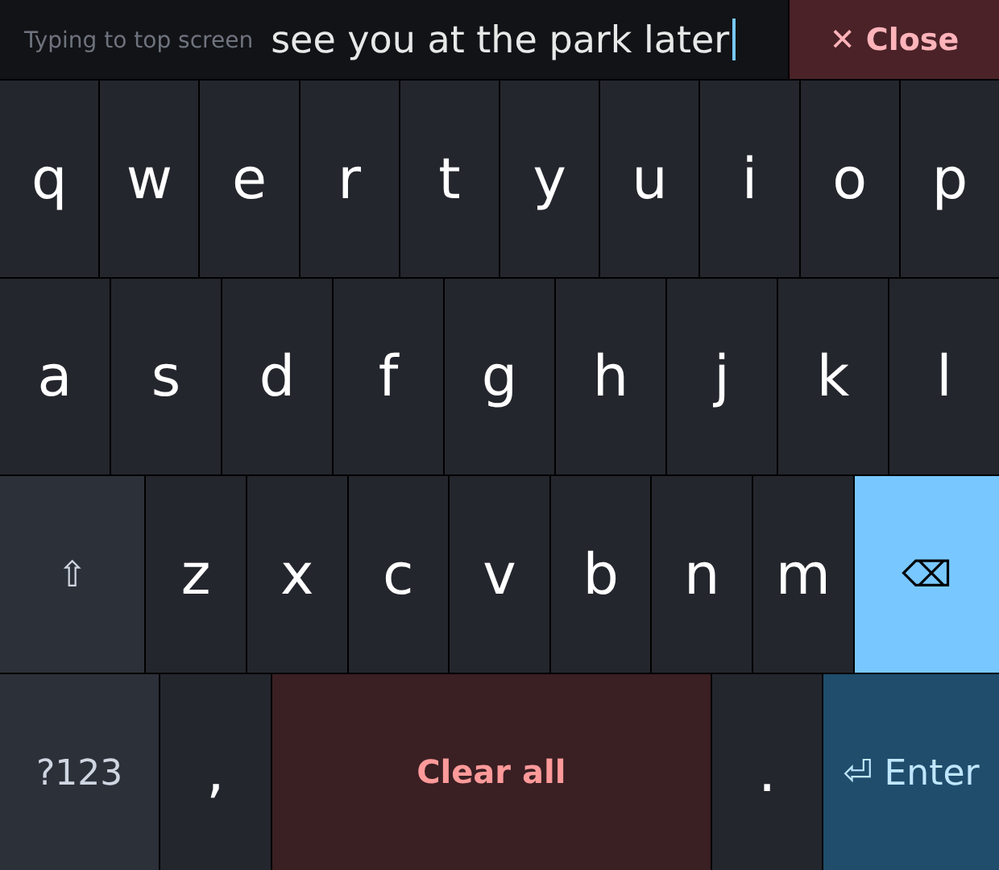 | 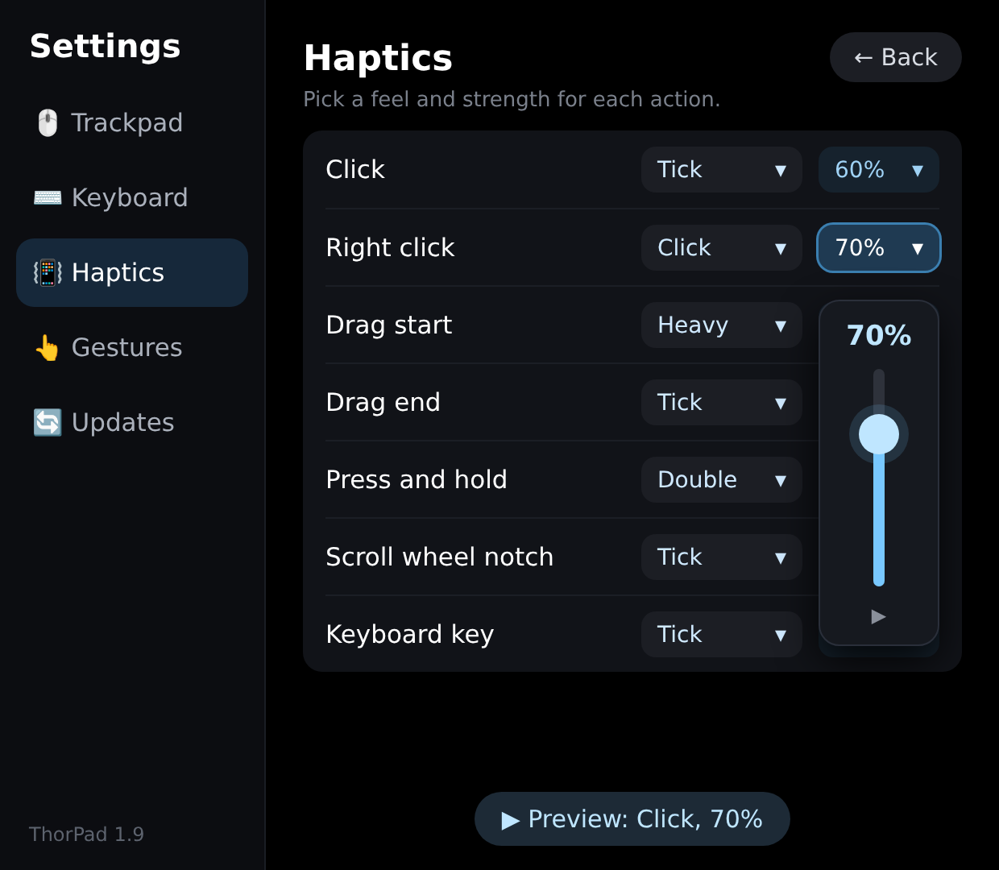 |
| ⌨️ Use ThorPad keyboard | 🎉 Update available, with what's new |
| 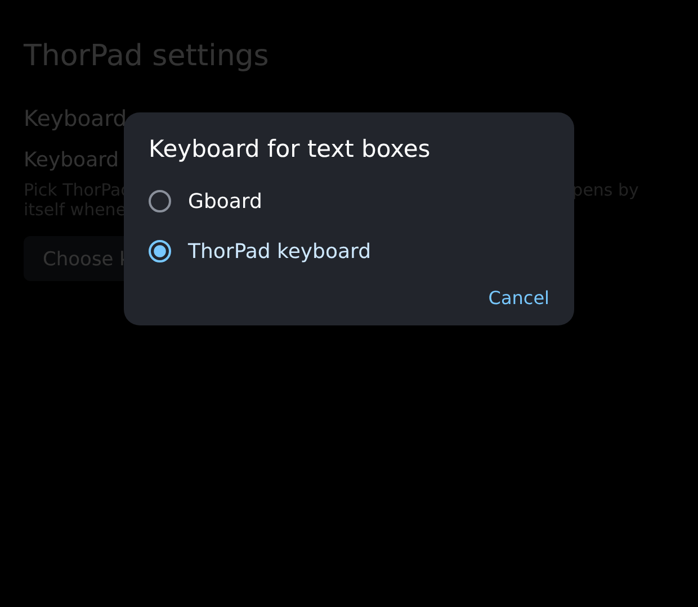 | 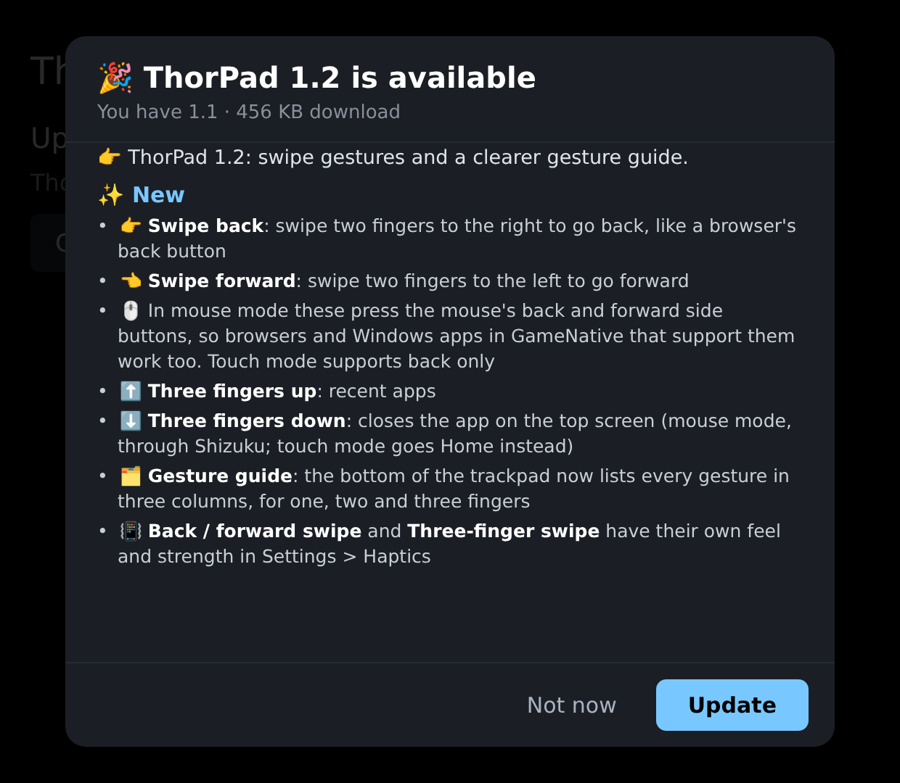 |
| 🖥️ PC keys (for Moonlight) | ✨ Mode menu: Auto, Android or PC |
| 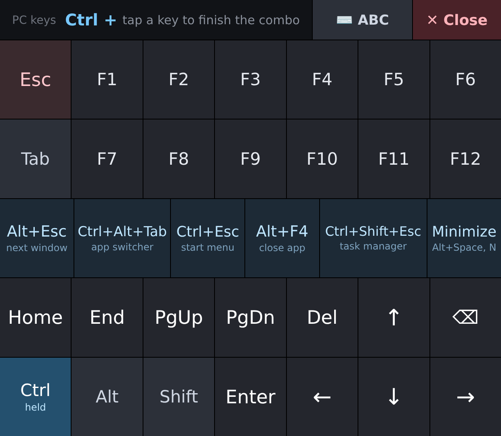 | 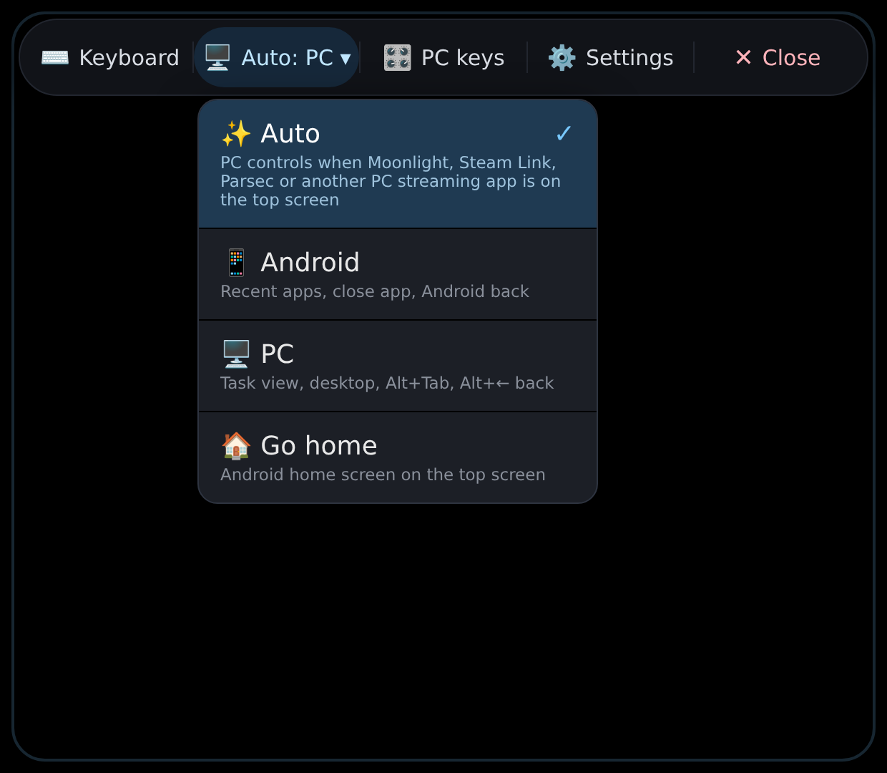 |
| 🚀 First-run setup | |
| 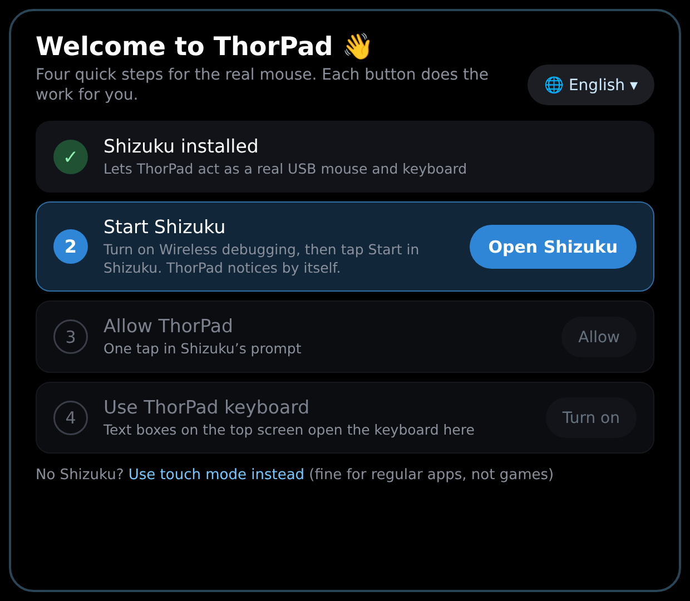 | |

## 👆 Gestures

| On the bottom screen | On the top screen |
|---|---|
| ☝️ Slide one finger | Moves the pointer (faster flicks travel further) |
| 👆 Tap | Click (a tap still counts if your finger rolls a little) |
| ✊ Tap, then quickly touch again, pause a moment, and slide | Drag (press, move, release) |
| ✌️ Two fingers up or down | Mouse wheel (real wheel notches in mouse mode) |
| 👉 Two fingers swiped right | Back, like a browser's back button (the mouse's back side button in mouse mode) |
| 👈 Two fingers swiped left | Forward (the mouse's forward side button; mouse mode only) |
| 🤟 Three fingers swiped up | Recent apps |
| 🤟 Three fingers swiped down | Closes the top-screen app (mouse mode, through Shizuku); Home in touch mode |
| 🤞 Two-finger tap, or press and hold | Right click in mouse mode; Back / long press in touch mode |

The bottom of the trackpad lists these gestures in three columns: one, two and three fingers.

The bar along the top has ⌨️ Keyboard, ✨ the mode menu, 🖥️ PC keys, ⚙️ Settings and ✖️ Close.

## 🖥️ PC mode (Moonlight and other PC streaming)

When the top screen is streaming a PC, gestures act on the PC instead of on Android (mouse mode
only, as the shortcuts go through the virtual keyboard):

| On the bottom screen | On the PC |
|---|---|
| 👉 / 👈 Two fingers swiped right / left | Back / forward (Alt+← / Alt+→, which every PC browser understands) |
| 🤟 Three fingers swiped up | Task view (Win+Tab) |
| 🤟 Three fingers swiped down | Show the desktop (Win+D) |
| 🤟 Three fingers swiped left or right | Switch app (Alt+Tab) |

- ✨ **Mode menu** (second button in the top bar): **Auto** switches to PC controls whenever
  Moonlight, a Moonlight fork, Steam Link, Parsec or a remote desktop app is on the top screen;
  **Android** and **PC** fix the mode. **Always PC for (app)** adds any other app. **Go home**
  shows the Android home screen. In Auto, ThorPad checks the top-screen app when you start
  touching the trackpad (at most every few seconds), never in the background.
- 🖥️ **PC keys** (third button): Esc, F1 to F12, one-tap Alt+Tab, Win+Tab, Win+D, Alt+F4,
  Ctrl+Shift+Esc and Print Screen, Home / End / Page Up / Page Down / Delete / Backspace and arrows.
  Ctrl, Alt, Shift and Win stay held after a tap and go with the next key, for any combo.
  **ABC** switches to the normal keyboard.

📳 **Haptics:** you feel a buzz for every action: taps, right clicks, the start and end of a drag,
press and hold, each scroll-wheel notch, back/forward and three-finger swipes, every keyboard key, Clear all, and the top-bar buttons.
In Settings > Haptics, each action gets its own feel (Off, Tick, Click, Heavy, Double or Buzz) and
strength, and every change plays a preview.

## ⌨️ Keyboard

**Keyboard** turns the whole bottom screen into a keyboard. The keys touch edge to edge, with
only a hairline between them, so the whole screen can be tapped. **✕ Close** returns to the trackpad.

- ⚡ Keys type the moment your finger lands (Settings can switch this to "type when the finger
  lifts", which lets you slide onto the right key). Each finger is tracked separately, so
  pressing the next key before lifting the last still counts. Every press flashes and buzzes.
- 🔣 **?123** and **=\<** switch to numbers, symbols, Esc, Tab and arrow keys. Tap ⇧ once for one
  capital letter, or twice quickly for caps lock. Hold ⌫ to keep deleting.
- 🧹 **Clear all:** while you hold ⌫, the space bar turns red and says **Clear all**. Tap it to wipe the whole text box.
- 🪄 **Opens by itself:** in Settings, tap **Use ThorPad keyboard** (it makes ThorPad Android's keyboard). Then whenever a
  text box on the top screen asks for a keyboard, ThorPad's keyboard opens on the bottom screen (if
  ThorPad is closed, just the keyboard appears over whatever is there), with no other keyboard popping up on the top screen. Keys
  go straight into the text box. When the top screen leaves the text box (or the app hides its
  keyboard, e.g. after Search, or with Shizuku you tap outside the text box), the keyboard closes again; one opened with the **Keyboard** button
  stays open until you close it. When a keyboard shown over another app
  closes, that app is right where you left it. With Shizuku, ThorPad switches keyboards for you; without it,
  Android asks you to turn the keyboard on and pick it. Text boxes drawn inside a Windows game in
  GameNative aren't Android text boxes, so open the keyboard yourself there.
- 🔌 Where the keys go: with ThorPad keyboard picked, straight into the selected text box. Otherwise, in
  mouse mode, ThorPad plugs in a virtual USB keyboard while the keyboard is open, so keys reach games
  and apps like a real keyboard; in touch mode, text goes into the selected text box.
- ✨ **Autocorrect** (on by default, switch in Settings) fixes a misspelled word when you finish it
  with a space or punctuation. While you type, the strip shows "→ correction"; tap the strip to keep
  your spelling. Pressing backspace right after a correction undoes it. Either way, ThorPad
  remembers that word and won't correct it again. It knows about 134,000 words, including names,
  slang and the apps and games people type (Gmail, TikTok, Minecraft, RetroArch...).
  It also:
  - 🧩 splits words that ran together (`helloworld` → `hello world`), including a letter typed by
    grazing the space bar (`seebyou` → `see you`)
  - 🔤 fixes missing, extra, doubled and swapped letters (`definately`, `tommorow`, `becuase`)
  - 🧠 uses the word before to pick the right word (`more then` → `more than`) and to tell `ill`
    from `I'll`
  - ✏️ adds apostrophes and fixes compound words (`dont` → `don't`, `alot` → `a lot`)
  - 🙅 leaves chat shorthand alone (lol, brb, omw...) and never corrects passwords, emails or web
    addresses
- ⏺️ **Double-space period:** two quick spaces type ". ".
- 🔠 **Auto-capitals:** sentences start with a capital letter, in text boxes that ask for one.

## ⚙️ Settings

- 🏎️ **Pointer speed** and **pointer acceleration**
- 📜 **Scroll speed**, and **classic scroll direction** (fingers down scrolls down, like a mouse wheel)
- 🔍 **Pointer size** (touch mode's pointer)
- 🔁 **Swap screens** (pointer on the bottom, trackpad on the top)
- 🔅 **Dim when idle** (on by default): after 30 seconds without a touch the trackpad screen dims to save battery; the next touch only wakes it
- ✨ **Autocorrect**, **double-space period** and **auto-capitals**, each on or off
- ✋ **Type when the finger lifts** (off by default, so keys type the instant you touch them)
- ⌨️ **Use ThorPad keyboard:** makes ThorPad Android's keyboard in one tap, so it opens by itself for top-screen text boxes (**Other keyboard** switches back)
- 📳 **Haptics:** a feel and strength for each action, with a preview as you change them
- 🔄 **Check for updates** (at the bottom): finds a newer ThorPad release on GitHub and shows what's
  new in every version since yours, newest first. Tap **Update** to download and install it, or **Not now**. With Shizuku it installs on its own; without it, Android shows its install prompt
  (the first time, allow ThorPad to install apps).
- 🔁 **Reinstall** (just below): downloads the latest release and installs it again even if it's the version you have, for when a release's APK was replaced

## 🔀 Two modes

🖱️ **Mouse mode (needed for GameNative / Winlator games).** ThorPad plugs in a
virtual USB mouse using Android's built-in `uinput` tool, started through
[Shizuku](https://github.com/RikkaApps/Shizuku). Android and every app see a real mouse: the
system cursor shows on the top screen, games get real mouse movement and button presses, and
two-finger scrolling sends real scroll-wheel notches (GameNative turns these into Windows
mouse-wheel events).

👆 **Touch mode (no Shizuku).** An accessibility service draws its own pointer and turns clicks and
scrolls into touch gestures. Fine for ordinary Android apps, but games in GameNative read those
as touches, not as a mouse.

ThorPad uses mouse mode whenever Shizuku is running and has allowed it, and falls back to touch mode otherwise.

## 📲 Install

1. Copy `ThorPad.apk` to the Thor and open it to install.
2. For mouse mode: install Shizuku, start it (Shizuku > Start via Wireless debugging), open
   ThorPad, tap **Allow ThorPad in Shizuku** and allow it. Shizuku has to be started again after each reboot.
3. For touch mode: tap **Accessibility settings** in ThorPad and turn on **ThorPad trackpad**.
   If Android says the setting is restricted: Settings > Apps > ThorPad > ⋮ > **Allow restricted settings**, then try again.
4. Optional: in ThorPad's Settings, tap **Use ThorPad keyboard**, so the
   keyboard opens by itself for text boxes on the top screen.

🔄 **Updating:** tap **Check for updates** at the bottom of ThorPad's Settings, or install the
newest `ThorPad.apk` from [Releases](https://github.com/ajhockey88/ThorPad/releases) over the old one.

## 🛠️ How it works

The Thor's own mouse mode is driven by AYN's input engine and the controller sticks; other
apps can only switch it on or off, not move its cursor. So ThorPad brings its own mouse.

Mouse mode: Shizuku runs `uinput -` as the shell user, and ThorPad streams it JSON commands
that register a USB mouse (BTN_LEFT/RIGHT/MIDDLE, REL_X/Y, REL_WHEEL/HWHEEL, plus
Back/Home/App-switch keys) and inject evdev events. While the keyboard is open, a second
`uinput` device acts as a USB keyboard (US layout); it is unplugged when the keyboard closes so
the top screen's own touch keyboard keeps working. Clicks hold the button about 90 ms, like a real
mouse, so games that check the button once per frame see them, and each click first nudges the
pointer a pixel and back to wake Android's cursor, which hides whenever the bottom screen is touched. ThorPad talks to Shizuku through a small
built-in client (`ShizukuClient`, `ShizukuBinderProvider`) using Shizuku's AIDL interface.

Touch mode:

- the pointer is an accessibility overlay window on the top display;
- clicks, long presses, drags and scrolls are touch gestures injected on the top display
  at the pointer (`dispatchGesture` with `setDisplayId`); scrolling holds a virtual finger
  under the pointer and moves it with your two fingers, so lists and pages scroll with
  momentum like a real swipe;
- the trackpad window never takes input focus, so the top-screen app keeps the gamepad
  and keyboard, and Back/Home/Apps act on the top screen.

ThorPad keyboard is an Android input method (`ThorPadIme`) with an empty view on the top screen.
When a text box asks for a keyboard, it opens the bottom-screen keyboard (starting the trackpad if
needed), and keys are committed to the text box through its input connection. Clear all is
select-all then delete.

Check for updates reads `releases/latest` from the GitHub API, compares its tag with the installed
version, shows the release notes (Markdown headers, bullets and bold), and on **Update** downloads the release's `.apk`, and installs it with `pm install` through Shizuku, or with
Android's package installer (which asks to confirm) when Shizuku isn't allowed.

🔒 ThorPad only goes online when you tap **Check for updates**, to read its GitHub releases and
download the new APK. Nothing else is sent anywhere. In touch mode it reads only the selected text box, to type into it, and nothing else on screen.

## 🙏 Credits

The autocorrect dictionary (`app/src/main/assets/words.txt`, built by `tools/make_dictionary.py`)
takes its spellings from SCOWL's "huge" American English word list (about 134,000 words with names, brands and gaming terms) and its word frequencies from
[wordfreq](https://github.com/rspeer/wordfreq) (data licensed CC BY-SA 4.0). Which words
follow which (`app/src/main/assets/pairs.txt`, built by `tools/make_pairs.py`) comes from
[SymSpell](https://github.com/mammothb/symspellpy)'s bigram list (MIT), drawn from Google Books
Ngram data (CC BY 3.0).

## 🏗️ Building

`./build.sh` builds `build/ThorPad.apk` with Ubuntu's packaged Android tools (see the
script header); it downloads the two jars it compiles against from Maven Central. The project
also has standard Gradle files, so it can be opened and built in Android Studio.

The signing key is not in this repository. `build.sh` reads it from `keystore/thorpad.jks`
(or `$KEYSTORE`) and creates a new one if missing; an APK signed with a different key has to
be uninstalled before it can replace an older install.
